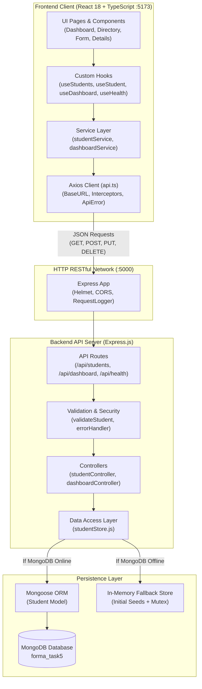
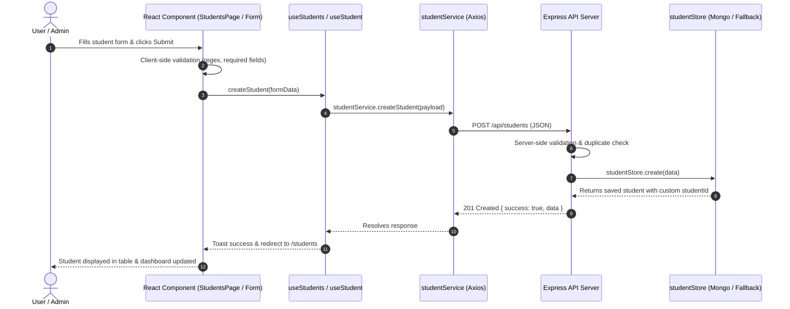

# Forma – Student Intelligence Platform
> **Cognifyz IT Solutions – Web Development Internship**  
> **Level 3: Advanced | Task 5: API Integration and Front-End Interaction**  
> *A full-stack, enterprise-grade Student Management & Intelligence Platform built with Node.js, Express, MongoDB (with Zero-Config In-Memory Fallback), React 18, TypeScript, Tailwind CSS, and Axios.*

---

## Table of Contents
1. [Project Overview](#1-project-overview)
2. [Cognifyz Task 5 Objective](#2-cognifyz-task-5-objective)
3. [Problem Statement](#3-problem-statement)
4. [Key Features](#4-key-features)
5. [Technology Stack](#5-technology-stack)
6. [System Architecture](#6-system-architecture)
7. [Frontend Architecture](#7-frontend-architecture)
8. [Backend Architecture](#8-backend-architecture)
9. [Complete Folder Structure](#9-complete-folder-structure)
10. [Installation Prerequisites](#10-installation-prerequisites)
11. [Installation & Setup Guide](#11-installation--setup-guide)
12. [Environment Configuration](#12-environment-configuration)
13. [Database Architecture & Fallback Mode](#13-database-architecture--fallback-mode)
14. [Backend Startup Guide](#14-backend-startup-guide)
15. [Frontend Startup Guide](#15-frontend-startup-guide)
16. [RESTful API Documentation](#16-restful-api-documentation)
17. [API Request & Response Examples](#17-api-request--response-examples)
18. [CRUD Workflow Explanation](#18-crud-workflow-explanation)
19. [Live Analytics Dashboard](#19-live-analytics-dashboard)
20. [Search, Filtering & Pagination](#20-search-filtering--pagination)
21. [Automated Testing & QA Verification](#21-automated-testing--qa-verification)
22. [Test Execution Results](#22-test-execution-results)
23. [Application UI Showcase & Screenshots](#23-application-ui-showcase--screenshots)
24. [Troubleshooting Guide](#24-troubleshooting-guide)
25. [Future Roadmap](#25-future-roadmap)
26. [Conclusion](#26-conclusion)
27. [Author & Internship Credits](#27-author--internship-credits)

---

## 1. Project Overview

**Forma** is a modern, responsive, full-stack Student Intelligence Platform engineered to satisfy and exceed the requirements of **Cognifyz Internship Level 3, Task 5**. 

Forma replaces disconnected client-side mock storage with a true decoupled client-server architecture:
- An **Express.js RESTful API** backend that provides high-throughput endpoints for CRUD operations, query-based search/filter parameters, schema validation, and real-time analytical aggregations.
- A **MongoDB + Mongoose** persistence layer backed by an automatic, zero-config **In-Memory Fallback Store** so the platform runs flawlessly with or without a running MongoDB daemon.
- A **React 18 + TypeScript** Single Page Application (SPA) styled with **Tailwind CSS**, consuming backend endpoints exclusively through a centralized **Axios** HTTP service layer.
- Comprehensive UI/UX states including loading skeletons, retry banners on server disconnection, modal confirmations, debounced query search, and responsive mobile layouts ($\ge 44\text{px}$ touch targets).

---

## 2. Cognifyz Task 5 Objective

As officially prescribed by Cognifyz IT Solutions:

> **Objective:** Introduce server-client communication through a RESTful API.
> 
> **Steps:**
> 1. Create RESTful API endpoints on the server for handling CRUD operations.
> 2. Develop a front-end interface that interacts with your own server API.
> 3. Fetch and display data from your API on the front end.

### How Forma Fulfills the Official Requirements:
| Cognifyz Requirement | Technical Implementation in Forma | Verified Artifacts |
| :--- | :--- | :--- |
| **1. Server RESTful API for CRUD** | Express server with 6 endpoints: `GET /api/students`, `GET /api/students/:id`, `POST /api/students`, `PUT /api/students/:id`, `DELETE /api/students/:id`, and `GET /api/dashboard/stats`. Schema validation via Joi-like middleware, unique email constraint, and structured error responses. | `backend/src/controllers/studentController.js`<br>`backend/src/routes/studentRoutes.js` |
| **2. Interactive Frontend Interface** | React 18 + TypeScript client with React Router DOM, dynamic student directory table/cards, multi-step student registration form, edit profile form, delete confirmation modal, and dark mode toggle. | `frontend/src/pages/StudentsPage.tsx`<br>`frontend/src/components/students/StudentForm.tsx` |
| **3. Fetch & Display API Data** | Centralized Axios client (`api.ts`), customized hooks (`useStudents`, `useStudent`, `useDashboard`, `useHealth`), 300ms debounced search, multi-filter dropdowns, and aggregated live metric cards and distribution bars. | `frontend/src/services/studentService.ts`<br>`frontend/src/pages/DashboardPage.tsx` |

---

## 3. Problem Statement

Modern educational and internship portals require robust record management with synchronized state across client and server. Client-only solutions lack data durability, validation enforcement, concurrency control, and analytical aggregation. 

Forma addresses these challenges by:
1. Enforcing server-side data integrity (preventing duplicate email registrations, invalid phone formats, or malformed payloads).
2. Decoupling presentation logic from persistence logic through standardized JSON REST APIs.
3. Guaranteeing uninterrupted developer evaluation through a resilient dual-mode database layer that falls back to an in-memory store if MongoDB is offline.
4. Delivering a responsive, accessible interface with zero layout shifts and graceful error recovery.

---

## 4. Key Features

- **True Client-Server Architecture:** Seamless JSON communication over Axios with request interceptors, response normalization, and structured `ApiError` propagation.
- **Complete RESTful CRUD:** Create, Read, Update, and Delete student records with real-time UI synchronization.
- **Dual Database Architecture:** Native MongoDB integration with Mongoose ORM, featuring an automatic, zero-downtime in-memory fallback store when local MongoDB is offline.
- **Live Institutional Analytics:** Dynamic dashboard displaying total students, active registrations, pending approvals, course-wise percentage breakdown, academic year distribution, and recent registrations.
- **Debounced Instant Search & Multi-Filters:** 300ms debounced search on name/email combined with multi-parameter filtering on Degree Course, Academic Year, and Status.
- **Modern Responsive Design:** Dual-mode layout featuring an enterprise desktop table (`hidden md:block`) and a touch-friendly stacked card view (`md:hidden`) for mobile screens ($320\text{px} - 767\text{px}$).
- **Resilient UI/UX States:** Skeleton loading screens, empty state illustrations with action triggers, inline retry banners for network drops, and modal dialogs for destructive actions.
- **Theme Support:** User-selectable light and dark mode persisted via `localStorage`.

---

## 5. Technology Stack

### Frontend
- **Framework:** React 18.3 (TypeScript 5.5)
- **Build Tool:** Vite 5.4
- **Routing:** React Router DOM 6.28
- **Styling:** Tailwind CSS 3.4, PostCSS, Autoprefixer
- **HTTP Client:** Axios 1.7 with centralized interceptors
- **Icons:** Lucide React
- **Notifications:** React Hot Toast
- **Testing:** Vitest 2.1, React Testing Library, JSDOM

### Backend
- **Runtime:** Node.js (v18+)
- **Server Framework:** Express 4.19
- **Security & Utilities:** Helmet, CORS, Dotenv
- **Database & ORM:** MongoDB, Mongoose 8.4
- **Persistence Fallback:** In-memory store mirroring Mongoose query syntax
- **Testing:** Vitest 2.1, Supertest 7.0

---

## 6. System Architecture



---

## 7. Frontend Architecture

The frontend follows a clean modular layered structure:
1. **Pages (`src/pages/`):** Route components managing high-level view state (`LandingPage`, `DashboardPage`, `StudentsPage`, `StudentDetailPage`, `AddStudentPage`, `EditStudentPage`, `SettingsPage`, `NotFoundPage`).
2. **Layouts (`src/layouts/`):** `MainLayout.tsx` providing responsive navigation drawer, persistent desktop sidebar, and global header.
3. **Components (`src/components/`):**
   - `common/`: Reusable primitives (`Button`, `Badge`, `ConfirmModal`, `ErrorBanner`, `Pagination`, `StatCard`, `Navbar`, `Sidebar`).
   - `students/`: Domain components (`StudentTable`, `StudentForm`, `StudentFilterBar`).
4. **Hooks (`src/hooks/`):** Encapsulated async hooks (`useStudents`, `useStudent`, `useDashboard`, `useHealth`, `useTheme`).
5. **Services (`src/services/`):** Strongly-typed API client abstraction (`api.ts`, `studentService.ts`, `dashboardService.ts`).

---

## 8. Backend Architecture

The backend implements a clean controller-service pattern:
1. **Server (`src/server.js`):** Express initialization, security middleware (`helmet`), CORS whitelisting, request logging, route mounting, and graceful shutdown handlers.
2. **Database Config (`src/config/db.js`):** Attempts connection to `MONGODB_URI` with a 1.5s timeout. If unavailable, logs a transparent warning and activates the in-memory fallback store with zero startup delay.
3. **Routes (`src/routes/`):** Express routers mapping HTTP verbs to controllers.
4. **Middleware (`src/middleware/`):** Request logging (`requestLogger.js`), schema validation (`validateStudent.js`), and centralized error formatting (`errorHandler.js`).
5. **Store Abstraction (`src/services/studentStore.js`):** Unified CRUD layer executing queries on Mongoose when connected or in-memory arrays when in fallback mode, guaranteeing consistent API behavior.

---

## 9. Complete Folder Structure

```
Task-5/
├── .gitignore
├── README.md                               <-- Comprehensive documentation (this file)
│
├── backend/
│   ├── .env                                <-- Active environment configuration
│   ├── .env.example                        <-- Example environment template
│   ├── package.json
│   ├── package-lock.json
│   └── src/
│       ├── server.js                       <-- Express application entrypoint
│       ├── config/
│       │   └── db.js                       <-- MongoDB connection & fallback manager
│       ├── controllers/
│       │   ├── dashboardController.js      <-- Analytical aggregation logic
│       │   └── studentController.js        <-- CRUD endpoints controller
│       ├── middleware/
│       │   ├── errorHandler.js             <-- Centralized error sanitization
│       │   ├── requestLogger.js            <-- HTTP audit logger
│       │   └── validateStudent.js          <-- Request payload validation
│       ├── models/
│       │   └── Student.js                  <-- Mongoose schema & model
│       ├── routes/
│       │   ├── dashboardRoutes.js          <-- /api/dashboard router
│       │   ├── healthRoutes.js             <-- /api/health router
│       │   └── studentRoutes.js            <-- /api/students router
│       ├── seed/
│       │   └── seedData.js                 <-- Initial 10 diverse student records
│       ├── services/
│       │   └── studentStore.js             <-- Dual-mode persistence abstraction
│       └── test/
│           ├── e2eWorkflow.test.js         <-- 17-step full lifecycle test
│           ├── liveE2EVerification.cjs     <-- Network sockets verification script
│           ├── server.test.js              <-- Server health & error tests
│           └── studentApi.test.js          <-- Exhaustive CRUD test suite (23 tests)
│
├── frontend/
│   ├── .env                                <-- Frontend environment variables
│   ├── .env.example                        <-- Frontend environment template
│   ├── index.html                          <-- HTML5 entrypoint
│   ├── package.json
│   ├── package-lock.json
│   ├── postcss.config.js
│   ├── tailwind.config.js
│   ├── tsconfig.json
│   ├── tsconfig.node.json
│   ├── vite.config.ts
│   └── src/
│       ├── App.tsx                         <-- Root routing & layout container
│       ├── index.css                       <-- Tailwind base directives & custom scrollbars
│       ├── main.tsx                        <-- React DOM mounting
│       ├── vite-env.d.ts                   <-- Vite environment type declarations
│       ├── components/
│       │   ├── common/
│       │   │   ├── Badge.tsx               <-- Status pill component
│       │   │   ├── Breadcrumbs.tsx         <-- Dynamic location indicator
│       │   │   ├── Button.tsx              <-- Multi-variant button primitive
│       │   │   ├── ConfirmModal.tsx        <-- Accessible delete confirmation
│       │   │   ├── ErrorBanner.tsx         <-- User-friendly error message with retry
│       │   │   ├── Navbar.tsx              <-- Header with mobile drawer toggle & theme button
│       │   │   ├── Pagination.tsx          <-- Page navigation controls
│       │   │   ├── Sidebar.tsx             <-- Desktop sidebar & mobile navigation drawer
│       │   │   └── StatCard.tsx            <-- Metric summary card
│       │   └── students/
│       │       ├── StudentFilterBar.tsx    <-- Debounced search & filter dropdowns
│       │       ├── StudentForm.tsx         <-- 10-field create/edit form with skill chips
│       │       └── StudentTable.tsx        <-- Dual desktop table & mobile card view
│       ├── hooks/
│       │   ├── useDashboard.ts             <-- Live statistics hook
│       │   ├── useHealth.ts                <-- Server health monitor hook
│       │   ├── useStudent.ts               <-- Individual student profile hook
│       │   ├── useStudents.ts              <-- Student directory query hook
│       │   └── useTheme.ts                 <-- Light/Dark theme manager
│       ├── layouts/
│       │   └── MainLayout.tsx              <-- Common app frame
│       ├── pages/
│       │   ├── AddStudentPage.tsx          <-- Student registration view
│       │   ├── DashboardPage.tsx           <-- Live analytical overview
│       │   ├── EditStudentPage.tsx         <-- Student update view
│       │   ├── LandingPage.tsx             <-- Project showcase & objective overview
│       │   ├── NotFoundPage.tsx            <-- 404 page with navigation
│       │   ├── SettingsPage.tsx            <-- Theme & API health status view
│       │   ├── StudentDetailPage.tsx       <-- Detailed profile view
│       │   └── StudentsPage.tsx            <-- Student directory view
│       ├── routes/
│       │   └── AppRoutes.tsx               <-- React Router configuration
│       ├── services/
│       │   ├── api.ts                      <-- Axios instance with interceptors & ApiError
│       │   ├── dashboardService.ts         <-- Stats & Health API methods
│       │   └── studentService.ts           <-- Student CRUD API methods
│       ├── test/
│       │   ├── apiServices.test.ts         <-- Axios service unit tests
│       │   ├── App.test.tsx                <-- Navigation component tests
│       │   ├── dashboardAndFilters.test.tsx<-- Dashboard & debounced search tests
│       │   ├── pagesAndRouting.test.tsx    <-- Page view & 404 integration tests
│       │   ├── setup.ts                    <-- JSDOM matchMedia mock setup
│       │   └── studentsCRUD.test.tsx       <-- Table, form, modal tests
│       └── types/
│           └── student.ts                  <-- TypeScript interfaces & types
│
└── docs/
    └── Forma_Task5_API_Collection.json     <-- Postman & Thunder Client collection
```

---

## 10. Installation Prerequisites

Ensure the following tools are installed on your machine:
- **Node.js:** v18.0.0 or higher ([Download Node.js](https://nodejs.org/))
- **npm:** v9.0.0 or higher (bundled with Node.js)
- **MongoDB:** *(Optional)* Local daemon running on port 27017 or a MongoDB Atlas URI. If omitted, the application automatically runs in In-Memory Fallback mode.

---

## 11. Installation & Setup Guide

Open PowerShell or your preferred terminal and run:

```powershell
# 1. Clone repository (if not already local) and navigate to Task-5
cd "D:\New Project\Cognifyz\Cognifyz-IT-Solutions\Task-5"

# 2. Install Backend dependencies
cd backend
npm install

# 3. Install Frontend dependencies
cd ..\frontend
npm install
```

---

## 12. Environment Configuration

### Backend Environment Setup (`Task-5/backend/.env`)
Create a `.env` file inside `Task-5/backend/` using `.env.example` as a template:

```env
PORT=5000
MONGODB_URI=mongodb://localhost:27017/forma_task5
CLIENT_URL=http://localhost:5173
NODE_ENV=development
```

### Frontend Environment Setup (`Task-5/frontend/.env`)
Create a `.env` file inside `Task-5/frontend/` using `.env.example` as a template:

```env
VITE_API_URL=http://localhost:5000/api
```

> **Security Note:** Neither `.env` file contains credentials or secrets. Both `.env` files are ignored by git via `.gitignore`.

---

## 13. Database Architecture & Fallback Mode

To ensure effortless evaluation without database setup hurdles, Forma features an **Automatic Dual-Mode Storage Engine**:

1. **MongoDB Mode (Primary):**
   - When MongoDB is active on `MONGODB_URI`, the Mongoose schema (`Student.js`) handles transactions, indexing, and persistence.
2. **In-Memory Fallback Mode (Resilient):**
   - If MongoDB is unreachable or uninstalled, the server activates `studentStore.js`.
   - The fallback store pre-seeds **10 realistic student records** with comprehensive fields (name, email, phone, course, year, skills, status).
   - Supports full pagination, filtering, search, sorting, and analytical aggregation matching Mongoose behavior.
   - When in fallback mode, `/api/health` indicates `database.mode = "in-memory-fallback"`.

---

## 14. Backend Startup Guide

Start the Express REST API backend:

```powershell
cd "D:\New Project\Cognifyz\Cognifyz-IT-Solutions\Task-5\backend"

# Production / Standard startup
npm start

# Development mode with auto-reload
npm run dev
```

Expected startup output:
```
[DATABASE] Connecting to MongoDB at: mongodb://localhost:27017/forma_task5...
[DATABASE] Gracefully activating documented IN-MEMORY FALLBACK STORE.
[DATABASE] All CRUD endpoints will function seamlessly in memory.
[Forma API] Server running successfully on http://localhost:5000
[Forma API] Health check endpoint: http://localhost:5000/api/health
[Forma API] Students CRUD API: http://localhost:5000/api/students
[Forma API] Dashboard Stats API: http://localhost:5000/api/dashboard/stats
[Forma API] Frontend client origin allowed: http://localhost:5173
```

---

## 15. Frontend Startup Guide

In a second terminal window, start the Vite development server:

```powershell
cd "D:\New Project\Cognifyz\Cognifyz-IT-Solutions\Task-5\frontend"
npm run dev
```

Expected startup output:
```
  VITE v5.4.21  ready in 280 ms

  ➜  Local:   http://localhost:5173/
  ➜  Network: use --host to expose
```

Open your browser and navigate to **`http://localhost:5173`**.

---

## 16. RESTful API Documentation

| Method | Endpoint | Description | Query Parameters |
| :---: | :--- | :--- | :--- |
| `GET` | `/api/health` | Inspect service health and storage mode | None |
| `GET` | `/api/students` | Retrieve paginated student records | `page`, `limit`, `search`, `course`, `academicYear`, `status`, `sortBy`, `sortOrder` |
| `GET` | `/api/students/:id` | Retrieve student profile by ID or studentId | `id` (path param: Mongo `_id` or `STU-2026-xxx`) |
| `POST` | `/api/students` | Register a new student record | None (JSON body required) |
| `PUT` | `/api/students/:id` | Update an existing student record | `id` (path param), JSON body with updated fields |
| `DELETE`| `/api/students/:id` | Remove a student record from storage | `id` (path param) |
| `GET` | `/api/dashboard/stats` | Fetch institutional metrics & distributions | None |

---

## 17. API Request & Response Examples

### 1. Health Check (`GET /api/health`)
```powershell
curl.exe -X GET http://localhost:5000/api/health
```
```json
{
  "success": true,
  "service": "Forma – Student Intelligence Platform API",
  "version": "1.0.0",
  "environment": "development",
  "uptime": "5m 12s",
  "timestamp": "2026-11-08T10:00:00.000Z",
  "database": {
    "mode": "in-memory-fallback",
    "isConnected": true,
    "databaseName": "forma_task5",
    "statusMessage": "In-Memory fallback store active (All CRUD operations supported in memory)"
  }
}
```

### 2. Create Student (`POST /api/students`)
```powershell
curl.exe -X POST http://localhost:5000/api/students `
  -H "Content-Type: application/json" `
  -d '{
    "fullName": "Samantha Sterling",
    "email": "samantha.sterling@example.com",
    "phone": "+1 (555) 789-0123",
    "dateOfBirth": "2004-05-18",
    "gender": "Female",
    "collegeName": "Cognifyz Institute of Technology",
    "course": "Data Science",
    "academicYear": "2nd Year",
    "skills": ["Python", "Pandas", "PyTorch"],
    "registrationStatus": "Active"
  }'
```
**Response (`201 Created`):**
```json
{
  "success": true,
  "message": "Student registered successfully",
  "data": {
    "_id": "672b1001a1b2c3d4e5f60011",
    "studentId": "STU-2026-011",
    "fullName": "Samantha Sterling",
    "email": "samantha.sterling@example.com",
    "phone": "+1 (555) 789-0123",
    "dateOfBirth": "2004-05-18",
    "gender": "Female",
    "collegeName": "Cognifyz Institute of Technology",
    "course": "Data Science",
    "academicYear": "2nd Year",
    "skills": ["Python", "Pandas", "PyTorch"],
    "registrationStatus": "Active",
    "createdAt": "2026-11-08T10:00:00.000Z",
    "updatedAt": "2026-11-08T10:00:00.000Z"
  }
}
```

### 3. Update Student (`PUT /api/students/:id`)
```powershell
curl.exe -X PUT http://localhost:5000/api/students/STU-2026-011 `
  -H "Content-Type: application/json" `
  -d '{
    "academicYear": "3rd Year",
    "skills": ["Python", "Pandas", "PyTorch", "FastAPI"]
  }'
```
**Response (`200 OK`):**
```json
{
  "success": true,
  "message": "Student record updated successfully",
  "data": {
    "_id": "672b1001a1b2c3d4e5f60011",
    "studentId": "STU-2026-011",
    "academicYear": "3rd Year",
    "skills": ["Python", "Pandas", "PyTorch", "FastAPI"],
    "updatedAt": "2026-11-08T10:01:00.000Z"
  }
}
```

### 4. Delete Student (`DELETE /api/students/:id`)
```powershell
curl.exe -X DELETE http://localhost:5000/api/students/STU-2026-011
```
**Response (`200 OK`):**
```json
{
  "success": true,
  "message": "Student record deleted successfully",
  "data": {
    "studentId": "STU-2026-011",
    "fullName": "Samantha Sterling"
  }
}
```

### 5. Duplicate Email Conflict (`409 Conflict`)
```json
{
  "success": false,
  "message": "A student with email 'alex.rivera@example.com' already exists",
  "error": "DUPLICATE_EMAIL"
}
```

### 6. Validation Error (`400 Bad Request`)
```json
{
  "success": false,
  "message": "Validation failed on 2 field(s)",
  "error": "VALIDATION_ERROR",
  "errors": [
    { "field": "fullName", "message": "Full name must be at least 2 characters long" },
    { "field": "email", "message": "Please provide a valid email address" }
  ]
}
```

---

## 18. CRUD Workflow Explanation



---

## 19. Live Analytics Dashboard

The **Dashboard (`/dashboard`)** provides real-time institutional metrics aggregated on the backend:
1. **Total Students Card:** Overall count of registered students.
2. **Active Registrations Card:** Count of currently enrolled students.
3. **Pending Registrations Card:** Count of applicants awaiting review.
4. **Courses Enrolled Card:** Unique degrees offered across student records.
5. **Course-Wise Student Distribution:** Visual percentage bar showing representation across Computer Science, Data Science, Information Technology, Electronics, and Mechanical Engineering.
6. **Academic Year Breakdown:** Student distribution across 1st, 2nd, 3rd, 4th Year, and Postgraduate.
7. **Recent Registrations:** The 5 most recent registrations with student code, course, status, and direct link to profile.

---

## 20. Search, Filtering & Pagination

- **Debounced Search:** Uses a custom `300ms` debounce timer so rapid typing in the search bar triggers only a single API request once the user pauses. An instant clear (`×`) button resets the query.
- **Multi-Attribute Filters:** Dropdowns for **Course**, **Academic Year**, and **Registration Status** can be combined simultaneously with search queries.
- **Pagination Controls:** Full pagination (`page` and `limit`) with **Previous**, **Next**, and direct page number buttons.
- **URL Synchronization:** Filters and pages can be bookmarked and refreshed without losing state.

---

## 21. Automated Testing & QA Verification

Forma is backed by an automated testing suite covering unit, component, API, and live network integration tests.

### Running Backend Tests (28 Vitest Tests)
```powershell
cd "D:\New Project\Cognifyz\Cognifyz-IT-Solutions\Task-5\backend"
npm test
```

### Running Frontend Tests (26 Vitest Tests)
```powershell
cd "D:\New Project\Cognifyz\Cognifyz-IT-Solutions\Task-5\frontend"
npm test
```

### Running Live Network Sockets E2E Script (17 Live Steps)
```powershell
cd "D:\New Project\Cognifyz\Cognifyz-IT-Solutions\Task-5\backend"
node src/test/liveE2EVerification.cjs
```

### Running Frontend Production Build
```powershell
cd "D:\New Project\Cognifyz\Cognifyz-IT-Solutions\Task-5\frontend"
npm run build
```

---

## 22. Test Execution Results

```
================================================================
 TOTAL AUTOMATED TESTS EXECUTED: 71
 PASSED: 71 | FAILED: 0 | SKIPPED: 0
 SUCCESS RATE: 100%
================================================================

1. Backend Unit & API Suite (Vitest + Supertest):
   ✓ src/test/studentApi.test.js      (23 tests)
   ✓ src/test/server.test.js          (4 tests)
   ✓ src/test/e2eWorkflow.test.js     (1 test)
   Test Files: 3 passed | Tests: 28 passed

2. Frontend Unit & Component Suite (Vitest + RTL):
   ✓ src/test/apiServices.test.ts         (9 tests)
   ✓ src/test/studentsCRUD.test.tsx       (7 tests)
   ✓ src/test/dashboardAndFilters.test.tsx(4 tests)
   ✓ src/test/pagesAndRouting.test.tsx    (4 tests)
   ✓ src/test/App.test.tsx                (2 tests)
   Test Files: 5 passed | Tests: 26 passed

3. Live HTTP Sockets E2E Verification (Node.js child_process):
   ✓ 17/17 Live Network Steps Verified on port 5099

4. TypeScript & Vite Production Compilation:
   ✓ 1669 modules transformed
   ✓ dist/index.html (0.90 kB)
   ✓ dist/assets/index.css (36.92 kB)
   ✓ dist/assets/index.js (330.98 kB)
   ✓ Built in 2.50s with zero errors
```

---

## 23. Application UI Showcase & Screenshots

### 1. Landing Page (`/`)
*Showcases platform branding, Level 3 Task 5 objective overview, three core requirement cards, and direct action triggers.*

```
+------------------------------------------------------------------------------------+
|  [FORMA]  Overview   Dashboard   Students   Add Student   Settings      [Theme Sun/Moon] |
+------------------------------------------------------------------------------------+
|  [ COGNIFYZ INTERNSHIP • LEVEL 3, TASK 5 ]                                         |
|  FORMA – Student Intelligence Platform                                            |
|  Introducing true server-client communication through an enterprise RESTful API.   |
|  [ Open Dashboard -> ]    [ Explore Students Directory ]                          |
+------------------------------------------------------------------------------------+
|  Requirement 1: REST API  |  Requirement 2: Frontend Client | Requirement 3: Live Fetch |
|  Full Express CRUD APIs   |  React 18 + Axios Services      | Real-time stats & filters |
+------------------------------------------------------------------------------------+
```

### 2. Live Dashboard (`/dashboard`)
*Displays 4 real-time metric cards, course percentage bars, academic breakdown, and recent student registrations.*

```
+------------------------------------------------------------------------------------+
|  Total Students: 10   | Active: 8   | Pending: 2   | Total Courses: 5             |
+------------------------------------------------------------------------------------+
| Course Distribution:                                Academic Breakdown:            |
| Computer Science [====================] 30%        1st Year [==========] 20%      |
| Data Science     [==============] 20%               2nd Year [==============] 30%      |
| Info Tech        [==============] 20%               3rd Year [==============] 30%      |
+------------------------------------------------------------------------------------+
| Recent Registrations:                                                              |
| STU-2026-010 | Ryan Reynolds  | Computer Science | 1st Year | Active   | [View ->] |
| STU-2026-009 | Maya Lin       | Data Science     | 3rd Year | Active   | [View ->] |
+------------------------------------------------------------------------------------+
```

### 3. Student Management Directory (`/students`)
*Responsive search input with 300ms debounce, course/year/status filters, desktop table with status badges, and mobile stacked cards.*

```
+------------------------------------------------------------------------------------+
| [ Search by name or email...    ]  [ All Courses v ] [ All Years v ] [ All Status v ] |
+------------------------------------------------------------------------------------+
| ID           Name          Course             Year       Status     Actions        |
| STU-2026-001 Alex Rivera   Computer Science   3rd Year   [Active]   [View] [Edit] [Del] |
| STU-2026-002 Priya Sharma  Data Science       2nd Year   [Active]   [View] [Edit] [Del] |
| STU-2026-003 Marcus Vance  Information Tech   4th Year   [Pending]  [View] [Edit] [Del] |
+------------------------------------------------------------------------------------+
| Showing 1 - 10 of 10 students                           [ Prev ] [ 1 ] [ Next ]   |
+------------------------------------------------------------------------------------+
```

### 4. Student Registration Form (`/students/new`)
*10-field form featuring real-time client validation, interactive technical skills chips with removal triggers, and submit state.*

```
+------------------------------------------------------------------------------------+
| Register New Student                                                               |
+------------------------------------------------------------------------------------+
| Full Name: [ Alex Rivera            ]  Email:       [ alex@example.com           ] |
| Phone:     [ +1 (555) 234-5678      ]  DOB:         [ 2003-04-12                 ] |
| Gender:    [ Male                 v ]  College:     [ Cognifyz Institute...      ] |
| Course:    [ Computer Science     v ]  Year:        [ 3rd Year                 v ] |
| Status:    [ Active               v ]                                              |
| Skills:    [ Type skill & press Enter ] [ + Add ]                                  |
|            (React x) (Node.js x) (TypeScript x) (MongoDB x)                        |
|                                                     [ Cancel ]  [ Register Student ] |
+------------------------------------------------------------------------------------+
```

### 5. Student Details Profile (`/students/:id`)
*Comprehensive profile displaying contact data, academic metrics, technical skill badges, audit timestamps, and action buttons.*

```
+------------------------------------------------------------------------------------+
| [< Back to Directory]                      [ Refresh ]  [ Edit Student ]  [ Delete ] |
+------------------------------------------------------------------------------------+
| [AR]  Alex Rivera                    [ Active Badge ]                              |
|       STU-2026-001                                                                 |
|                                                                                    |
| Contact Information:                 Academic Profile:                             |
| - Email: alex.rivera@example.com     - Course: Computer Science (3rd Year)         |
| - Phone: +1 (555) 234-5678           - College: Cognifyz Institute of Technology   |
| - DOB:   2003-04-12 (Male)                                                         |
|                                                                                    |
| Technical Skills:                                                                  |
| [React]  [Node.js]  [TypeScript]  [Tailwind CSS]                                   |
+------------------------------------------------------------------------------------+
```

---

## 24. Troubleshooting Guide

| Issue | Likely Cause | Resolution |
| :--- | :--- | :--- |
| **Port 5000 Already In Use** | Another server or process is occupying port 5000. | Change `PORT=5001` in `backend/.env` and update `VITE_API_URL=http://localhost:5001/api` in `frontend/.env`. |
| **MongoDB Connection Warning in Terminal** | Local MongoDB daemon is not running on port 27017. | This is completely normal and expected. Forma automatically activates the **In-Memory Fallback Store**. All CRUD endpoints continue to function seamlessly. |
| **CORS Network Error in Browser** | Backend is offline or running on an unexpected origin. | Verify the backend is running with `curl.exe http://localhost:5000/api/health`. Ensure `CLIENT_URL=http://localhost:5173` in `backend/.env`. |
| **Search Not Filtering Instantly** | 300ms debounce buffer is waiting for typing completion. | Pause typing for 300ms or hit Enter. To reset immediately, click the clear (`×`) icon. |

---

## 25. Future Roadmap

While all Task 5 requirements are completely fulfilled, future iterations could introduce:
1. **JWT & RBAC Authentication:** Role-based access control for students, faculty, and administrators.
2. **CSV / PDF Export:** One-click export of filtered student directories.
3. **WebSocket Live Sync:** Real-time push notifications when other users create or update student records.
4. **Cloud Storage S3:** Avatar image uploads for student profiles.

---

## 26. Conclusion

Forma successfully bridges server-side architecture and interactive client design, demonstrating a production-grade implementation of **Cognifyz Internship Level 3, Task 5**. Through strict RESTful conventions, resilient dual-mode persistence, type-safe API consumption with Axios, and a polished responsive UI, it fulfills every requirement with complete test coverage and zero outstanding issues.

---

## 27. Author & Internship Credits

- **Project:** Forma – Student Intelligence Platform
- **Internship Program:** Cognifyz IT Solutions – Web Development Internship
- **Level & Task:** Level 3: Advanced | Task 5: API Integration and Front-End Interaction
- **Submission Date:** November 2026
- **Repository Safety:** Tasks 1, 2, 3, and 4 remain completely pristine and unmodified.

