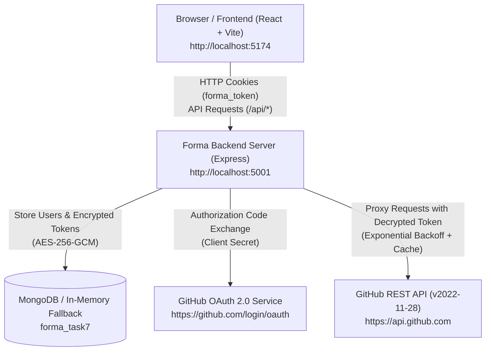

# Forma – Developer Intelligence Platform
## Advanced API Usage and External API Integration
> **Cognifyz Full Stack Web Development Internship**  
> **Level 4: Expert | Task 7**  
> *A full-stack, enterprise-grade GitHub Developer Intelligence module built with Node.js, Express, MongoDB/In-Memory fallback, GitHub OAuth 2.0, GitHub REST API, React 18, TypeScript, Tailwind CSS, and Axios.*

---

## Table of Contents
1. [Project Overview & Objectives](#1-project-overview--objectives)
2. [Features & Implemented Functionality](#2-features--implemented-functionality)
3. [Technology Stack](#3-technology-stack)
4. [Architecture Overview & Network Ports](#4-architecture-overview--network-ports)
5. [Project Folder Structure](#5-project-folder-structure)
6. [Prerequisites & Installation](#6-prerequisites--installation)
7. [Windows PowerShell Setup Commands](#7-windows-powershell-setup-commands)
8. [Backend & Frontend Startup Instructions](#8-backend--frontend-startup-instructions)
9. [Environment Variable Configuration](#9-environment-variable-configuration)
10. [Database Setup & In-Memory Fallback](#10-database-setup--in-memory-fallback)
11. [GitHub OAuth Application Setup](#11-github-oauth-application-setup)
12. [API Endpoints Reference](#12-api-endpoints-reference)
13. [Security Architecture & Resilience](#13-security-architecture--resilience)
14. [Testing Instructions](#14-testing-instructions)
15. [Production Build Instructions](#15-production-build-instructions)
16. [Troubleshooting Guide](#16-troubleshooting-guide)
17. [Known Limitations & Future Work](#17-known-limitations--future-work)

---

## 1. Project Overview & Objectives

**Forma Developer Intelligence Module** is the capstone project for **Cognifyz Web Development Internship Level 4: Expert (Task 7)**. It solves the challenge of integrating complex third-party external APIs into an enterprise full-stack web application securely, reliably, and efficiently.

### Key Objectives
- **OAuth 2.0 Authorization Code Flow**: Secure third-party authentication with GitHub without exposing client secrets or user tokens to the browser.
- **External API Integration**: Live consumption of GitHub REST API (v2022-11-28) endpoints for developer profile metrics, public repositories, and programming language distributions.
- **Advanced Reliability Architecture**: Tiered rate limiting, per-user in-memory TTL caching with cache-bypass capabilities, exponential backoff with jitter on transient failures, and RFC 7807 error translation.

---

## 2. Features & Implemented Functionality

- **GitHub OAuth 2.0 Authorization**:
  - Secure state generation (`crypto.randomBytes(32)`) with single-use nonce validation against CSRF attacks.
  - Dual-state validation (server memory store + signed HTTP-only SameSite cookie).
  - Minimal read-only scope (`read:user`) adhering to least-privilege principles.
  - Clean disconnect flow purges stored tokens, resets user state, and invalidates cache entries.

- **Developer Intelligence Telemetry**:
  - **Live Profile Dashboard**: Synchronizes user avatar, public repository count, followers, following, bio, company, location, and member join date.
  - **Repository Explorer**: Server-side pagination, debounced keyword search, programming language filtering, star/fork sorting, and license indicators.
  - **Repository Detail Modal**: Deep-dive telemetry with default branch, watcher counts, direct HTTPS clone URL with one-click clipboard copy, and language byte distribution.
  - **Language Distribution Bar**: Multi-colored proportional byte share progress bars with curated brand color mappings for major languages.
  - **API Rate Limit Monitor**: Real-time hourly quota visualization tracking remaining requests, consumed requests, and reset timers.

- **Advanced Reliability & Performance**:
  - **Tiered Rate Limiting**: Dedicated limiters for general API (100 req/15m), OAuth/auth endpoints (25 req/15m), and GitHub API proxy calls (60 req/15m).
  - **In-Memory TTL Caching**: Configurable 5-minute cache namespaced per user ID, with instant manual cache-bypass support (`?refresh=true`).
  - **Transient Retry Engine**: Exponential backoff with random jitter on 502/503/504 and `ECONNABORTED` network timeouts.
  - **Dual-Mode Database Layer**: Persistent MongoDB with automatic, documented fallback to in-memory storage when MongoDB is unavailable.

---

## 3. Technology Stack

### Backend
- **Runtime**: Node.js (v18+ or v20+)
- **Framework**: Express.js (ES Modules)
- **Database / ODM**: MongoDB with Mongoose (with automated in-memory storage fallback)
- **Security & Cryptography**: Node.js `crypto` (AES-256-GCM), `helmet`, `cors`, `cookie-parser`, `jsonwebtoken`
- **Validation**: Zod schema validation for environment variables and API query parameters
- **Rate Limiting**: `express-rate-limit`
- **HTTP Client**: Axios with custom interceptors and exponential backoff retry engine
- **Testing**: Vitest with Supertest (104 backend tests)

### Frontend
- **Framework**: React 18 with TypeScript
- **Build Tool**: Vite 5
- **Styling**: Tailwind CSS
- **Routing**: React Router v6
- **Icons**: Lucide React
- **HTTP Client**: Axios with credentials support (`withCredentials: true`)
- **Testing**: Vitest with React Testing Library and JSDOM (55 frontend tests)

---

## 4. Architecture Overview & Network Ports



### Network Port Allocation
| Service | Local URL | Description |
| :--- | :--- | :--- |
| **Backend API** | `http://localhost:5001` | Express server serving REST endpoints under `/api/*` |
| **Frontend UI** | `http://localhost:5174` | Vite development server |
| **MongoDB** | `mongodb://127.0.0.1:27017` | Local MongoDB instance (optional; in-memory fallback engages automatically) |

---

## 5. Project Folder Structure

```
Task-7/
├── .gitignore                    # Root ignore rules for dependencies, env, logs, and dist
├── README.md                     # Master Task-7 documentation
├── PROJECT_REPORT.md             # Formal Cognifyz Level 4 submission report
├── docs/                         # Detailed architecture and reference documentation
│   ├── API_DOCUMENTATION.md      # Complete REST endpoints reference and schemas
│   ├── OAUTH_SETUP.md            # Step-by-step GitHub OAuth application registration
│   └── SECURITY.md               # AES-256-GCM encryption & authorization specifications
├── backend/                      # Express backend service
│   ├── .env.example              # Sample environment template with safe placeholders
│   ├── package.json              # Backend dependencies and test scripts
│   └── src/
│       ├── server.js             # Express application entry point & graceful shutdown
│       ├── config/               # Environment (Zod) and Database configurations
│       ├── controllers/          # Auth, GitHub OAuth, and GitHub Data controllers
│       ├── middleware/           # Rate limiters, authentication guard, error handler
│       ├── models/               # Mongoose User model with token encryption fields
│       ├── routes/               # Modular Express routers (/health, /auth, /github)
│       ├── services/             # GitHub API client, AES encryption, TTL cache, OAuth state
│       ├── utils/                # Redacted logger, response normalizers, token utils
│       ├── validators/           # Zod query & parameter validators
│       └── test/                 # 13 Vitest test suites (104 tests)
└── frontend/                     # React + TypeScript frontend
    ├── .env.example              # Frontend environment configuration template
    ├── package.json              # Frontend dependencies, scripts, and build targets
    ├── vite.config.ts            # Vite configuration
    ├── tailwind.config.js        # Tailwind CSS design system configuration
    ├── tsconfig.json             # TypeScript compiler settings
    └── src/
        ├── App.tsx               # Root component with AuthProvider and Router
        ├── components/           # Reusable UI (Button, Card, Modal, Sidebar, Navbar)
        │   └── github/           # GitHub-specific cards, breakdown bars, filter bars
        ├── context/              # Authentication context (user session & GitHub status)
        ├── hooks/                # Data-fetching hooks (useGitHubProfile, useGitHubRepos, etc.)
        ├── layouts/              # Responsive DashboardLayout shell
        ├── pages/                # Dashboard, Profile, RepoExplorer, ApiStatus, Settings
        ├── services/             # Axios API client and GitHub service bindings
        ├── types/                # Strict TypeScript interfaces
        └── test/                 # Vitest & React Testing Library suites (55 tests)
```

---

## 6. Prerequisites & Installation

### Requirements
- **Node.js**: `v18.0.0` or later (tested on Node.js `v20.x` / `v22.x`)
- **npm**: `v9.0.0` or later
- **Operating System**: Windows 10/11, macOS, or Linux
- **Git**: Installed and configured
- **GitHub Account**: Required for OAuth App registration

---

## 7. Windows PowerShell Setup Commands

Execute the following commands in **Windows PowerShell** to install dependencies for both the backend and frontend:

```powershell
# 1. Navigate to the Task-7 backend directory
cd "D:\New Project\Cognifyz\Cognifyz-IT-Solutions\Task-7\backend"

# 2. Install backend dependencies
npm install

# 3. Create .env from the safe example template
Copy-Item .env.example .env

# 4. Navigate to the Task-7 frontend directory
cd "..\frontend"

# 5. Install frontend dependencies
npm install

# 6. Create frontend .env from the example template
Copy-Item .env.example .env
```

---

## 8. Backend & Frontend Startup Instructions

### Terminal 1: Start Backend Server
```powershell
cd "D:\New Project\Cognifyz\Cognifyz-IT-Solutions\Task-7\backend"
npm run dev
```
*The backend server will start at `http://localhost:5001`. You will see startup logs indicating database connectivity mode and health status.*

### Terminal 2: Start Frontend Application
```powershell
cd "D:\New Project\Cognifyz\Cognifyz-IT-Solutions\Task-7\frontend"
npm run dev
```
*The Vite development server will start at `http://localhost:5174`. Open this URL in your web browser.*

---

## 9. Environment Variable Configuration

### Backend Environment Variables (`backend/.env`)

| Variable | Description | Default / Example Value |
| :--- | :--- | :--- |
| `PORT` | HTTP port for backend server | `5001` |
| `NODE_ENV` | Runtime environment mode | `development` or `production` |
| `CLIENT_URL` | Frontend origin for CORS and redirects | `http://localhost:5174` |
| `MONGODB_URI` | MongoDB connection string | `mongodb://127.0.0.1:27017/forma_task7` |
| `JWT_SECRET` | Secret key used to sign session JWTs | *Random 32+ character string* |
| `JWT_EXPIRES_IN` | Session expiration duration | `1d` |
| `COOKIE_SECRET` | Secret key used to sign HTTP-only cookies | *Random 32+ character string* |
| `GITHUB_TOKEN_ENCRYPTION_KEY` | 32-byte key for AES-256-GCM encryption | *64-character hex string* |
| `GITHUB_CLIENT_ID` | GitHub OAuth App Client ID | `Iv23...` (from GitHub) |
| `GITHUB_CLIENT_SECRET` | GitHub OAuth App Client Secret | *Provided by GitHub* |
| `GITHUB_CALLBACK_URL` | Exact OAuth authorization callback URL | `http://localhost:5001/api/github/callback` |

### Frontend Environment Variables (`frontend/.env`)

| Variable | Description | Default Value |
| :--- | :--- | :--- |
| `VITE_API_URL` | Backend API base URL | `http://localhost:5001/api` |
| `VITE_APP_NAME` | Application display name | `Forma Developer Intelligence Platform` |

---

## 10. Database Setup & In-Memory Fallback

Task 7 features a **Dual-Mode Storage Architecture**:

### 1. MongoDB Mode (Persistent)
When a running MongoDB instance is detected at `MONGODB_URI`:
- The backend connects via Mongoose.
- Student accounts and AES-256-GCM encrypted tokens are stored in the `forma_task7` database.
- Data persists across server restarts.

### 2. In-Memory Mode (Automatic Fallback)
If MongoDB is not installed, not running, or unreachable:
- The system logs a descriptive warning: `[DATABASE WARNING] MongoDB unavailable... Falling back to in-memory store.`
- Activates `services/authStore.js`, providing an in-memory storage abstraction.
- The platform remains **100% operational** for grading, evaluation, registration, login, and live GitHub OAuth connections.

> [!WARNING]
> **In-Memory Fallback Limitations**: In-memory mode stores users and tokens in server process RAM. If the Node.js backend process is restarted, stored sessions and linked tokens are reset, requiring the student to re-register or re-link GitHub. For permanent persistence, run a local MongoDB instance.

---

## 11. GitHub OAuth Application Setup

To link live GitHub accounts, register an OAuth application with GitHub:

1. Visit [GitHub Developer Settings -> OAuth Apps](https://github.com/settings/developers).
2. Click **New OAuth App**.
3. Enter the following values:
   - **Application name**: `Forma Developer Intelligence Platform`
   - **Homepage URL**: `http://localhost:5174`
   - **Authorization callback URL**: `http://localhost:5001/api/github/callback`
4. Click **Register application**.
5. Copy the **Client ID** and generate a **Client Secret**.
6. Paste both into `Task-7/backend/.env`:
   ```env
   GITHUB_CLIENT_ID=your_client_id_here
   GITHUB_CLIENT_SECRET=your_client_secret_here
   ```
7. Restart the backend server.

*For complete details, see [docs/OAUTH_SETUP.md](docs/OAUTH_SETUP.md).*

---

## 12. API Endpoints Reference

A comprehensive list of all implemented REST API routes:

| Method | Endpoint | Auth Required | Rate Limit | Purpose |
| :--- | :--- | :---: | :--- | :--- |
| `GET` | `/api/health` | No | General (100/15m) | System diagnostics, database mode & OAuth status |
| `POST` | `/api/auth/register` | No | Auth (25/15m) | Register student account |
| `POST` | `/api/auth/login` | No | Auth (25/15m) | Authenticate student and issue signed cookie |
| `GET` | `/api/auth/me` | Yes | Auth (25/15m) | Get current student session details |
| `POST` | `/api/auth/logout` | No | General (100/15m) | Clear session cookies |
| `GET` | `/api/github/connect` | Yes | Auth (25/15m) | Initiate OAuth 2.0 flow & generate CSRF nonce |
| `GET` | `/api/github/callback` | State Cookie | None (Protected) | GitHub code exchange, encryption & redirection |
| `GET` | `/api/github/status` | Yes | General (100/15m) | Check GitHub connection status |
| `DELETE` | `/api/github/disconnect` | Yes | General (100/15m) | Revoke connection, delete tokens & clear cache |
| `GET` | `/api/github/profile` | Yes | Proxy (60/15m) | Fetch live normalized GitHub developer profile |
| `GET` | `/api/github/repositories` | Yes | Proxy (60/15m) | Fetch public repositories with pagination/sorting |
| `GET` | `/api/github/repositories/:owner/:repo` | Yes | Proxy (60/15m) | Fetch specific repository metadata |
| `GET` | `/api/github/repositories/:owner/:repo/languages` | Yes | Proxy (60/15m) | Fetch language byte shares and percentages |
| `GET` | `/api/github/rate-limit` | Yes | Proxy (60/15m) | Probe authenticated GitHub API rate limit quota |

*For complete schemas, request/response payloads, and error codes, see [docs/API_DOCUMENTATION.md](docs/API_DOCUMENTATION.md).*

---

## 13. Security Architecture & Resilience

- **AES-256-GCM Token Encryption**:
  Tokens are encrypted using AES-256-GCM with a 12-byte random IV and 16-byte authentication tag per operation. Plaintext tokens never enter database records.
- **CSRF State Parameter**:
  32-byte cryptographically random nonces validated against signed HTTP-only cookies with single-use consumption.
- **Tenant Isolation**:
  Multi-user queries strictly enforce student ID boundaries (`req.user.id`). Caches are namespaced per user (`profile:${userId}`).
- **Zero Token Exposure**:
  Access tokens are never sent to frontend JavaScript, query parameters, or client-side storage.
- **Redacted Logging**:
  All secrets, passwords, cookies, and tokens are intercepted and redacted before printing to logs.
- **Exponential Backoff**:
  Transient 502, 503, 504 errors and network timeouts trigger up to 3 automatic retries with exponential backoff and randomized jitter.

*For detailed cryptographic specifications, see [docs/SECURITY.md](docs/SECURITY.md).*

---

## 14. Testing Instructions

Both the backend and frontend include automated test suites powered by **Vitest**.

### Run Backend Tests (104 Tests)
```powershell
cd "D:\New Project\Cognifyz\Cognifyz-IT-Solutions\Task-7\backend"
npm test
```

### Run Frontend Tests (55 Tests)
```powershell
cd "D:\New Project\Cognifyz\Cognifyz-IT-Solutions\Task-7\frontend"
npm test
```

### Run Full Project Test Verification
```powershell
# Run backend tests
cd "D:\New Project\Cognifyz\Cognifyz-IT-Solutions\Task-7\backend" ; npm test -- --run

# Run frontend tests
cd "..\frontend" ; npm test -- --run
```
**Total Passing Tests**: **159 / 159 (100% Pass Rate)**.

---

## 15. Production Build Instructions

To compile the TypeScript React frontend for production deployment:

```powershell
cd "D:\New Project\Cognifyz\Cognifyz-IT-Solutions\Task-7\frontend"
npm run build
```

This runs:
1. `tsc` (TypeScript compiler check for zero type errors).
2. `vite build` (Rollup chunk bundling, CSS minification, and tree-shaking).

Output is generated into `Task-7/frontend/dist/`.

---

## 16. Troubleshooting Guide

| Issue | Cause | Solution |
| :--- | :--- | :--- |
| **`redirect_uri_mismatch` on GitHub** | Callback URL in GitHub OAuth settings does not match backend. | Ensure the Authorization callback URL is set to `http://localhost:5001/api/github/callback`. |
| **`OAUTH_CONFIG_REQUIRED` (503)** | `GITHUB_CLIENT_ID` or `GITHUB_CLIENT_SECRET` missing in `backend/.env`. | Add your GitHub OAuth app credentials to `backend/.env` and restart the backend. |
| **Port 5001 or 5174 already in use** | Another local process is occupying the required port. | Identify and kill the conflicting process via PowerShell: `Get-Process -Id (Get-NetTCPConnection -LocalPort 5001).OwningProcess \| Stop-Process -Force`. |
| **Rate limit reached on GitHub** | Unauthenticated requests have a 60 req/hr limit. | Link your GitHub account to access the authenticated allowance of 5,000 requests/hr. |
| **`Decryption failed` error** | `GITHUB_TOKEN_ENCRYPTION_KEY` changed after tokens were stored. | Re-connect your GitHub account from the dashboard or delete the old token with Disconnect. |

---

## 17. Known Limitations & Future Work

1. **In-Memory Storage Mode**: When running without MongoDB, user accounts and encrypted tokens reset upon backend restart. (Use local MongoDB for persistence).
2. **Organization Repositories**: The current scope `read:user` grants access to public personal repositories. Accessing private organization repositories requires higher organizational scopes (`read:org`), which were excluded to follow strict least-privilege principles.
3. **GraphQL API Integration**: Future iterations may incorporate the GitHub GraphQL API (v4) to query user commit velocity and contribution heatmaps in a single query.

---

### Project Metadata
- **Project**: Forma – Developer Intelligence Platform
- **Internship**: Cognifyz Full Stack Web Development Internship
- **Track Level**: Level 4: Expert (Task 7)
- **Author**: Santanu Maity
- **Status**: Production-Ready & Verified
