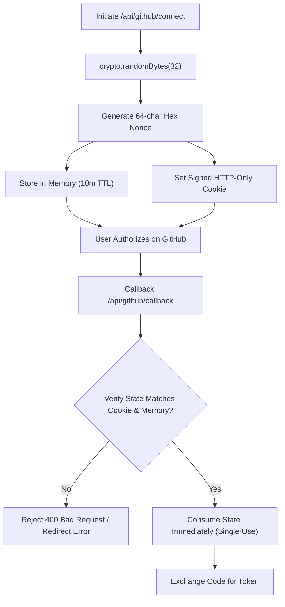

# Security Architecture & Authorization Specifications
## Forma – Developer Intelligence Platform
> **Cognifyz Full Stack Web Development Internship**  
> **Level 4: Expert | Task 7: Advanced API Usage and External API Integration**  

---

## 1. Overview & Threat Modeling

The Forma Developer Intelligence Platform connects to sensitive third-party services (GitHub REST API) on behalf of authenticated students. To protect user privacy, prevent unauthorized cross-tenant data access, and eliminate token leakage, the system implements defense-in-depth security across every architectural layer.

---

## 2. OAuth 2.0 Security & CSRF Defense

Cross-Site Request Forgery (CSRF) in OAuth flows can allow an attacker to bind their own GitHub account or intercept authorization codes. The platform eliminates this threat through:



### Key Controls
- **High Entropy State**: Nonces are generated via Node.js native `crypto.randomBytes(32)` providing 256 bits of cryptographic entropy.
- **Dual-State Verification**: The incoming `state` parameter must match both the server-side memory store and the signed HTTP-only cookie (`github_oauth_state`).
- **Single-Use Enforcement**: Immediately upon verification, the state is deleted from `oauthStateStore`. Any replay attempt is rejected.
- **Short-Lived Expiration**: Unconsumed states expire automatically after 10 minutes (600,000ms).

---

## 3. AES-256-GCM Token Encryption at Rest

GitHub access tokens grant access to user profile data and repositories. Tokens must never be stored in plaintext.

### Encryption Specifications (NIST SP 800-38D Compliant)
- **Algorithm**: `aes-256-gcm` (Galois/Counter Mode).
- **Key Length**: Exactly 32 bytes (256 bits), supplied as a 64-character hex string in `GITHUB_TOKEN_ENCRYPTION_KEY`.
- **Initialization Vector (IV)**: 12 bytes (96 bits) cryptographically random IV generated uniquely for *each* encryption operation using `crypto.randomBytes(12)`.
- **Authentication Tag**: 16 bytes (128 bits) calculated by the GCM cipher.
- **Serialized Storage Format**:
  $$\text{Payload} = \text{IV}_{\text{hex}} : \text{AuthTag}_{\text{hex}} : \text{Ciphertext}_{\text{hex}}$$

```
[ 24 hex chars (IV) ] : [ 32 hex chars (Auth Tag) ] : [ Variable hex chars (Ciphertext) ]
```

### Cryptographic Integrity Verification
During decryption, `decipher.setAuthTag()` verifies the 16-byte authentication tag. If an attacker tampers with even a single bit of the stored IV, ciphertext, or auth tag, the operation fails and throws:
`Decryption failed: integrity check failed or invalid key`.

---

## 4. Key Separation Architecture

Security best practices mandate that keys serving different cryptographic functions remain completely isolated:

| Secret Key | Variable Name | Purpose | Minimum Length |
| :--- | :--- | :--- | :--- |
| **Token Encryption Key** | `GITHUB_TOKEN_ENCRYPTION_KEY` | Encrypts GitHub access tokens at rest | Exactly 32 bytes (64 hex chars) |
| **JWT Session Secret** | `JWT_SECRET` | Signs user session tokens | At least 32 characters |
| **Cookie Signing Secret** | `COOKIE_SECRET` | Signs HTTP-only session cookies | At least 32 characters |
| **OAuth Client Secret** | `GITHUB_CLIENT_SECRET` | Authenticates backend to GitHub | Provided by GitHub |

---

## 5. Zero Client Token Exposure

- **No Browser Transmission**: GitHub access tokens are **never** returned in API responses, included in URLs, or stored in frontend `localStorage` / `sessionStorage`.
- **Backend-Only Decryption**: Access tokens are decrypted strictly in server memory during the execution of backend requests to `https://api.github.com`. Decrypted tokens are never assigned to long-lived variables.
- **Session Authentication**: The frontend communicates with the backend solely via signed, HTTP-only cookies (`forma_token`).

---

## 6. Multi-User & Tenant Isolation

In multi-user platforms, data must remain strictly isolated across students:

### Isolation Invariants
1. **User Ownership Guard**: All GitHub routes (`/profile`, `/repositories`, `/rate-limit`) resolve the authenticated student ID from the verified session cookie (`req.user.id`).
2. **Tenant Cache Namespacing**: Cache entries are prefixed by user ID:
   - `profile:${userId}`
   - `repos:${userId}:${queryKey}`
   - `languages:${userId}:${owner}:${repo}`
3. **Session Purge on Disconnect**: Calling `DELETE /api/github/disconnect` deletes the user's encrypted access token from the database, removes all associated cached entries, and resets connection metadata.

---

## 7. Redacted Logging & Secret Masking

The centralized logging utility (`utils/logger.js`) ensures that secrets are never accidentally leaked into server logs:
- Automatically masks tokens, client secrets, passwords, cookies, and `Authorization` headers.
- Secrets shorter than 6 characters are replaced with `'****'`.
- Longer secrets show only the first 4 characters and last 4 characters (`Iv23****9aB`).
- Stack traces and internal database errors are suppressed in production mode (`NODE_ENV=production`).

---

## 8. Tiered Rate Limiting Defense

To prevent brute-force attacks, credential stuffing, and quota exhaustion, `express-rate-limit` enforces:
1. **General API Limiter**: 100 requests per 15 minutes per IP on all routes.
2. **Authentication Limiter**: 25 requests per 15 minutes per IP on `/api/auth/*` and `/api/github/connect`.
3. **GitHub Proxy Limiter**: 60 requests per 15 minutes per IP on `/api/github/profile`, `/api/github/repositories/*`, and `/api/github/rate-limit`.

Exceeded limits return HTTP 429 with standard `RateLimit-*` and `Retry-After` headers.

---

## 9. Security Audit Test Suite

The security controls are validated by an automated test suite located at:  
`Task-7/backend/src/test/securityAudit.test.js`

**Test Suite Coverage (15/15 Tests Passing)**:
- High entropy verification of 32-byte CSRF state nonces.
- Rejection of expired and reused state nonces.
- AES-256-GCM encryption at rest verification.
- Rejection of tampered ciphertext and modified authentication tags.
- Verification that tokens never leak in `/api/github/status`.
- Cross-tenant isolation verification between User A and User B.
- Cache cross-contamination prevention between tenants.
- Input validation and parameter sanitization (regex validation of `:owner` and `:repo`).
- Enforcing 401 Unauthorized boundaries on protected endpoints.

