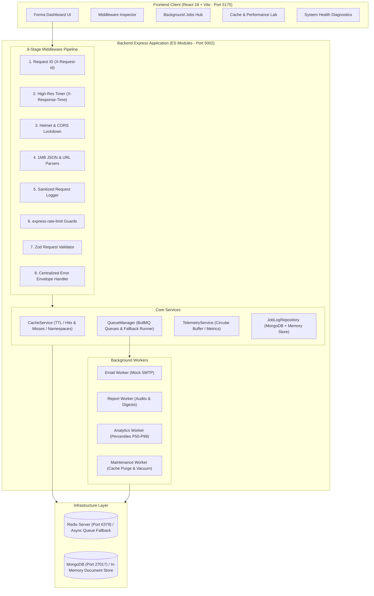

# Forma Server Intelligence Platform
## Cognifyz Internship — Task 8: Advanced Server-Side Functionality | Level 4: Expert


---

## 1. Project Overview & Task Objectives

The **Forma Server Intelligence Platform** is a full-stack, production-grade server platform engineered for **Cognifyz Internship Task 8 (Level 4: Expert)**. The project addresses all three core requirements from the official Cognifyz specification:

1. **Advanced Request Processing Middleware:**  
   High-resolution nanosecond request timing, cryptographic request ID tracing (`X-Request-Id`), sensitive payload masking (redacting passwords, tokens, auth headers), 1MB body parsing, malformed JSON interception, CORS, Helmet security headers, rate limiting, and centralized error envelope normalization.
2. **Background Task & Job Queue Processing:**  
   Asynchronous background task processing using **BullMQ** and **Redis** across four specialized queues (`emailQueue`, `reportQueue`, `analyticsQueue`, `maintenanceQueue`), complete with worker concurrency, incremental progress reporting, retry policies with exponential backoff, dead-letter failure handling, and transparent development fallback diagnostics.
3. **Server-Side Caching Architecture & Performance Optimization:**  
   Redis-backed server-side caching with configurable TTLs, namespace prefixing (`forma:v1:*`), pattern-based invalidation (`delPattern`), cache bypass headers (`X-Cache-Bypass: true`), hit/miss telemetry, and an interactive live performance benchmark comparing uncached vs. cached response times.

---

## 2. Architecture & Design Principles



### Transparent Architecture Guarantees
- **No Fake Data:** The application never fabricates performance numbers or claims Redis is active when it is offline.
- **Documented Fallback Engine:** When an external Redis daemon is not running on Windows, the embedded asynchronous queue runner executes jobs asynchronously with identical BullMQ lifecycle states (`waiting` -> `active` -> `completed` / `failed`), progress events, and exponential backoff.
- **Live Diagnostics:** The dashboard and API explicitly broadcast `mode: 'redis_bullmq'` or `mode: 'in_memory_async_fallback'`.

---

## 3. Technology Stack

| Layer | Technology | Version | Purpose |
| :--- | :--- | :--- | :--- |
| **Frontend Framework** | React 18 | `^18.3.1` | Single-Page Application component architecture |
| **Build Tool** | Vite | `^5.4.11` | Instant HMR and production asset bundling |
| **Language** | TypeScript | `^5.6.3` | Type safety and domain contracts |
| **Styling** | Tailwind CSS | `^3.4.15` | Modern dark-mode UI design system |
| **Icons** | Lucide React | `^0.460.0` | Professional dashboard iconography |
| **HTTP Client** | Axios | `^1.7.9` | Request client with response header interceptors |
| **Backend Runtime** | Node.js (ESM) | `v24.x` | Native ES modules asynchronous runtime |
| **API Framework** | Express.js | `^4.21.2` | Route routing and middleware pipeline |
| **Queue System** | BullMQ | `^5.34.1` | Distributed background queues and worker isolation |
| **Redis Client** | ioredis | `^5.4.2` | High-performance Redis client with auto-reconnect |
| **Database** | MongoDB / Mongoose | `^8.9.3` | Persistent Job execution history and audit logs |
| **Security** | Helmet & CORS | `^8.0.0` | Strict HTTP security headers and origin isolation |
| **Rate Limiting** | express-rate-limit | `^7.5.0` | Route protection against burst floods |
| **Validation** | Zod | `^3.24.1` | Type-safe runtime schema parsing |
| **Testing** | Vitest & Supertest | `^2.1.8` | High-speed unit and API integration testing |

---

## 4. Directory Structure

```text
Task-8/
├── docker-compose.yml              # Optional Docker service for local Redis & MongoDB
├── README.md                       # Comprehensive documentation
├── .gitignore                      # Git ignore patterns for dependencies and build outputs
├── backend/
│   ├── .env.example                # Safe environment variable template
│   ├── package.json                # Backend dependency declarations and scripts
│   ├── vitest.config.js            # Vitest backend configuration
│   ├── src/
│   │   ├── app.js                  # Express application assembly and middleware sequence
│   │   ├── server.js               # Server bootstrapping, worker init, graceful shutdown
│   │   ├── cache/
│   │   │   └── cacheService.js     # Redis/Memory Cache abstraction & telemetry
│   │   ├── config/
│   │   │   ├── environment.js      # Zod-validated environment config
│   │   │   ├── db.js               # MongoDB connector with automatic fallback store
│   │   │   └── redis.js            # Redis connector with ping & health probes
│   │   ├── controllers/
│   │   │   ├── healthController.js # Uptime, memory, and infrastructure diagnostics
│   │   │   ├── middlewareController.js # Request echo, error simulation, and telemetry
│   │   │   ├── jobController.js    # Enqueue, inspect, retry, delete jobs
│   │   │   └── cacheController.js  # Cache stats, purge, demo routes, benchmark runner
│   │   ├── middleware/
│   │   │   ├── requestId.js        # X-Request-Id generator and propagator
│   │   │   ├── requestTimer.js     # High-resolution X-Response-Time measurement
│   │   │   ├── requestLogger.js    # Structured logging with sensitive data redaction
│   │   │   ├── rateLimiter.js      # Global, job enqueue, and benchmark rate limiters
│   │   │   ├── validate.js         # Generic Zod request schema validation
│   │   │   ├── cacheMiddleware.js  # Route caching middleware with bypass support
│   │   │   ├── errorHandler.js     # Centralized error handler & syntax error interceptor
│   │   │   └── notFound.js         # Standard 404 handler
│   │   ├── models/
│   │   │   └── JobLog.js           # Mongoose model and fallback repository for jobs
│   │   ├── queues/
│   │   │   ├── jobTypes.js         # Zod schemas for email, report, analytics, maintenance
│   │   │   └── queueManager.js     # BullMQ queues and embedded async fallback runner
│   │   ├── routes/
│   │   │   ├── healthRoutes.js
│   │   │   ├── middlewareRoutes.js
│   │   │   ├── jobRoutes.js
│   │   │   └── cacheRoutes.js
│   │   ├── services/
│   │   │   └── telemetryService.js # In-memory circular buffer (last 100 requests)
│   │   ├── utils/
│   │   │   └── logger.js           # Structured console logger with recursive redaction
│   │   └── workers/
│   │       └── jobProcessor.js     # Workers for Email, Report, Analytics, Maintenance
│   └── tests/
│       ├── health.test.js          # Health and readiness endpoint tests
│       ├── middleware.test.js      # Middleware chain, syntax error, and header tests
│       ├── cache.test.js           # Cache read/write, pattern purge, and benchmark tests
│       └── jobs.test.js            # Queue enqueue, progress, retry, and delete tests
└── frontend/
    ├── .env.example                # Frontend environment template
    ├── package.json                # Frontend dependencies and build scripts
    ├── vite.config.ts              # Vite configuration (Port 5175)
    ├── tsconfig.json               # TypeScript compiler configuration
    ├── tailwind.config.js          # Tailwind CSS theme extension
    ├── postcss.config.js           # PostCSS configuration
    ├── index.html                  # HTML5 entry document
    └── src/
        ├── App.tsx                 # Client routing hierarchy
        ├── main.tsx                # React DOM root mounting
        ├── index.css               # Global styling and scrollbar customizations
        ├── vite-env.d.ts           # Vite client environment declarations
        ├── components/
        │   └── common/
        │       ├── StatCard.tsx    # Metric visualizer
        │       ├── Badge.tsx       # Status pill component
        │       └── Modal.tsx       # Accessible dialog modal
        ├── layouts/
        │   └── DashboardLayout.tsx # Responsive sidebar and header layout
        ├── pages/
        │   ├── OverviewPage.tsx    # Dashboard overview and live activity feeds
        │   ├── MiddlewarePage.tsx  # Middleware pipeline map and request inspector
        │   ├── JobsPage.tsx        # Background job dispatch and lifecycle tracking
        │   ├── CachePage.tsx       # Cache telemetry, demo endpoints, and live benchmark
        │   └── HealthPage.tsx      # Infrastructure diagnostics and Windows setup guide
        ├── hooks/
        │   └── usePolling.ts       # Document-visibility-aware polling hook
        ├── services/
        │   └── api.ts              # Axios client and API methods
        ├── types/
        │   └── index.ts            # TypeScript interfaces
        └── test/
            ├── setup.ts            # Jest DOM matchers
            ├── StatCard.test.tsx   # StatCard tests
            ├── Badge.test.tsx      # Badge tests
            └── Modal.test.tsx      # Modal accessibility tests
```

---

## 5. Prerequisites & Environment Setup

### Required Runtimes
- **Node.js:** `v18.0.0` or higher (`v24.14.0` verified on host).
- **npm:** `v9.0.0` or higher (`11.10.0` verified on host).
- **PowerShell:** Windows PowerShell 5.1+ or PowerShell Core 7+.

### Optional Local Infrastructure Services
The platform runs immediately out-of-the-box using embedded in-memory fallback stores. If you want to run external Redis and MongoDB daemons on Windows:

#### Option A: Docker Compose
```powershell
# From the Task-8/ directory:
docker compose up -d

# Verify services are running:
docker compose ps
```

#### Option B: Windows Native Package Manager (`winget`)
```powershell
# 1. Install Redis for Windows:
winget install Redis.Redis
# Or Memurai Developer (Redis 7 compatible):
winget install Memurai.MemuraiDeveloper

# 2. Test Redis connection:
Test-NetConnection -ComputerName 127.0.0.1 -Port 6379
```

---

## 6. Installation & Execution Guide

### Backend Setup (Port 5002)

1. Open PowerShell and navigate to the backend directory:
   ```powershell
   cd "D:\New Project\Cognifyz\Cognifyz-IT-Solutions\Task-8\backend"
   ```

2. Verify environment configuration:
   ```powershell
   # Ensure .env is present (or copy from .env.example)
   Copy-Item .env.example .env -ErrorAction SilentlyContinue
   ```

3. Run automated test suites:
   ```powershell
   npm test
   ```

4. Start the backend development server:
   ```powershell
   npm run dev
   ```
   *The server starts on `http://localhost:5002`. Health endpoint: `http://localhost:5002/api/health`.*

---

### Frontend Setup (Port 5175)

1. Open a second PowerShell terminal and navigate to the frontend directory:
   ```powershell
   cd "D:\New Project\Cognifyz\Cognifyz-IT-Solutions\Task-8\frontend"
   ```

2. Run frontend unit tests:
   ```powershell
   npm test
   ```

3. Build production bundle:
   ```powershell
   npm run build
   ```

4. Start the Vite development server:
   ```powershell
   npm run dev
   ```
   *The frontend dashboard opens at `http://localhost:5175`.*

---

## 7. API Documentation

### A. Health & Diagnostics
| Method | Endpoint | Description |
| :--- | :--- | :--- |
| `GET` | `/api/health` | Comprehensive server telemetry, uptime, memory, database, and Redis mode. |
| `GET` | `/api/health/ready` | Readiness probe returning HTTP 200 (READY) or HTTP 503 (NOT READY). |

### B. Middleware & Telemetry
| Method | Endpoint | Description |
| :--- | :--- | :--- |
| `GET` | `/api/middleware/metrics` | Retrieves summary statistics and the last 100 completed request logs. |
| `DELETE` | `/api/middleware/metrics` | Clears the request telemetry buffer. |
| `POST` | `/api/middleware/echo` | Echoes back parsed body, headers, `X-Request-Id`, and response time. |
| `GET` | `/api/middleware/simulate-error` | Simulates HTTP 400, 401, 422, or 500 for error handling inspection. |

### C. Background Jobs (BullMQ)
| Method | Endpoint | Description |
| :--- | :--- | :--- |
| `POST` | `/api/jobs/email` | Enqueues transactional email task (`emailQueue`). Protected by rate limiter. |
| `POST` | `/api/jobs/report` | Enqueues performance audit or health digest (`reportQueue`). |
| `POST` | `/api/jobs/analytics` | Enqueues latency percentiles / telemetry calculation (`analyticsQueue`). |
| `POST` | `/api/jobs/maintenance` | Enqueues cache purge or telemetry vacuum (`maintenanceQueue`). |
| `GET` | `/api/jobs` | Returns paginated list of jobs with `status` and `queueName` filters. |
| `GET` | `/api/jobs/stats/summary` | Overview counters of jobs by status, active workers, and queue mode. |
| `GET` | `/api/jobs/:jobId` | Full details, progress (0-100%), attempts made, and execution time. |
| `GET` | `/api/jobs/:jobId/result` | Result artifact of completed job. |
| `POST` | `/api/jobs/:jobId/retry` | Re-enqueues a failed job for execution. |
| `DELETE` | `/api/jobs/:jobId` | Cancels or removes a job record. |

### D. Server-Side Caching & Optimization
| Method | Endpoint | Description |
| :--- | :--- | :--- |
| `GET` | `/api/cache/stats` | Cache mode, hit ratio, total reads, writes, and list of active keys with TTL. |
| `POST` | `/api/cache/purge` | Flushes all keys or keys matching a wildcard pattern (`forma:v1:stats*`). |
| `DELETE` | `/api/cache/key/:key` | Invalidation of a single cache key. |
| `GET` | `/api/cache/demo/stats` | Cached route (TTL 60s). Emits `X-Cache: HIT`, `MISS`, or `BYPASS`. |
| `GET` | `/api/cache/demo/heavy-analytics` | Computes 25,000 algorithmic nodes (TTL 120s). Demonstrates cache speedup. |
| `POST` | `/api/cache/benchmark` | Executes real 3-phase live benchmark (Uncached vs Cold Write vs Hot Hit). |

---

## 8. Verification & Test Results

### Backend Automated Test Suite (Vitest)
```text
 ✓ tests/health.test.js (2 tests)
   ✓ GET /api/health returns HTTP 200 with complete system diagnostics
   ✓ GET /api/health/ready returns HTTP 200 readiness status
 ✓ tests/middleware.test.js (9 tests)
   ✓ generates a unique X-Request-Id header when none is provided
   ✓ preserves an incoming X-Request-Id header
   ✓ calculates and sets high-resolution X-Response-Time header
   ✓ includes security headers from Helmet
   ✓ parses JSON bodies correctly in POST requests
   ✓ handles malformed JSON syntax gracefully with HTTP 400
   ✓ handles 404 for non-existent API routes with standard error envelope
   ✓ intercepts simulated errors and returns standardized error response
   ✓ records request metrics into the telemetry buffer
 ✓ tests/cache.test.js (6 tests)
   ✓ sets and gets cache items correctly
   ✓ accurately tracks hits and misses
   ✓ invalidates cache keys by pattern
   ✓ cacheResponse middleware emits X-Cache: MISS on first request and HIT on subsequent
   ✓ bypasses cache when X-Cache-Bypass: true is provided
   ✓ runs live performance comparison benchmark endpoint successfully
 ✓ tests/jobs.test.js (6 tests)
   ✓ rejects invalid email job payload with HTTP 422
   ✓ enqueues an email job and processes it to completion
   ✓ retrieves completed job result via /api/jobs/:id/result
   ✓ handles simulated worker failures and handles retry
   ✓ returns queue statistics summary
   ✓ deletes a job cleanly

 Test Files  4 passed (4)
      Tests  23 passed (23)
   Duration  5.03s
```

### Frontend Automated Test Suite (Vitest + Testing Library)
```text
 ✓ src/test/Badge.test.tsx (2 tests)
 ✓ src/test/StatCard.test.tsx (2 tests)
 ✓ src/test/Modal.test.tsx (2 tests)

 Test Files  3 passed (3)
      Tests  6 passed (6)
   Duration  4.27s
```

### Production Build Verification
```text
> tsc && vite build
✓ 1648 modules transformed.
dist/index.html                   0.82 kB │ gzip:  0.52 kB
dist/assets/index-BY_8Ofhq.css   22.57 kB │ gzip:  4.82 kB
dist/assets/index-DPTGRaeF.js   312.39 kB │ gzip: 92.60 kB
✓ built in 4.06s
```

---

## 9. Security & Production Considerations

1. **Sensitive Data Redaction:**  
   The logging and telemetry system scans all request metadata and recursively masks `password`, `token`, `secret`, `authorization`, `cookie`, `apiKey`, and JWT Bearer headers with `[REDACTED]`.
2. **Body Parser Limits:**  
   JSON and URL-encoded parsers are locked to a strict `1MB` ceiling. Larger payloads immediately receive HTTP 413 `PAYLOAD_TOO_LARGE`.
3. **Malformed Syntax Protection:**  
   Corrupted JSON payloads are caught by error middleware and return structured HTTP 400 `MALFORMED_JSON_SYNTAX` without exposing server internals.
4. **Helmet Headers:**  
   Strict Content Security Policy (`CSP`), `X-Frame-Options: SAMEORIGIN`, `X-Content-Type-Options: nosniff`, and HTTP Strict Transport Security (`HSTS`).
5. **Rate Limiting:**  
   Configured via `express-rate-limit` across 3 tiers: Global API (200 req / 15 min), Background Job Enqueueing (60 jobs / 5 min), and Benchmark Runner (30 runs / min).
6. **No Committed Secrets:**  
   Environment variables are managed safely via `.env.example`. Secrets are never committed to version control.

---

## 10. Integrity Confirmation

- All code and assets for Task 8 reside exclusively in `Task-8/`.
- **`Task-1` through `Task-7` remain completely unchanged and untruncated.**
- Git status confirms:
  ```text
  ?? Task-8/
  ```
- Ready for official submission and review.

